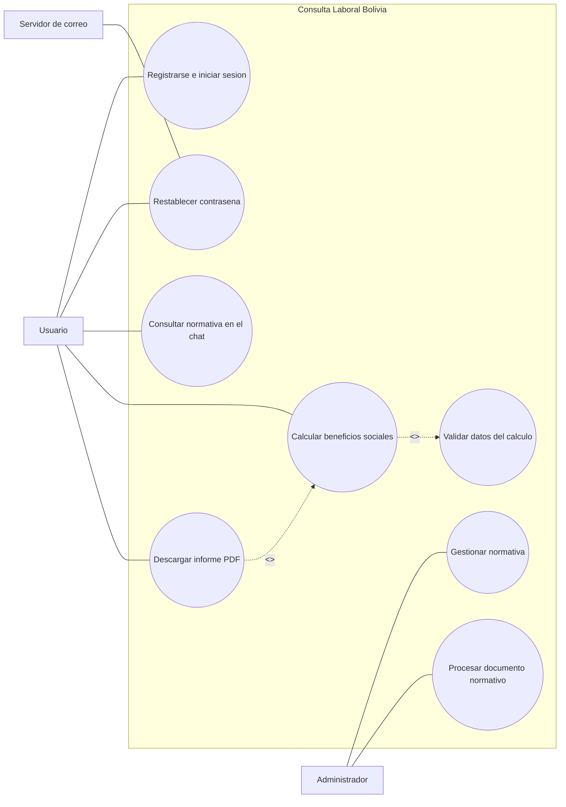
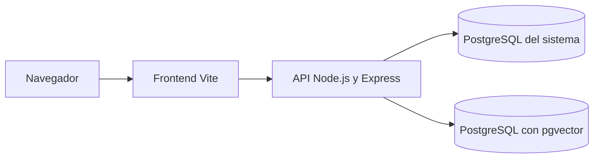

# Actividad de Autoaprendizaje

## Aplicacion: Consulta Laboral Bolivia

En esta actividad se aplican los conceptos de ingenieria de software al sistema de consulta laboral, calculo de beneficios sociales y administracion de normativa. Se distingue entre las funciones que ya ofrece el proyecto, las pruebas que existen y las mejoras propuestas. Las metricas propuestas no representan resultados medidos.

# Parte I: Conceptos fundamentales de ingenieria de software

## 1. Requisitos funcionales y no funcionales

### Requisitos funcionales (RF)

Los requisitos funcionales indican que servicios o acciones debe ofrecer el sistema. Se validan comprobando sus entradas, reglas y resultados.

| ID | Requisito aplicado a Consulta Laboral Bolivia | Como comprobarlo |
|---|---|---|
| RF-01 | El sistema debe permitir que una persona se registre e inicie sesion. | Registrar un usuario de prueba y verificar que pueda iniciar sesion con sus credenciales. |
| RF-02 | El sistema debe enviar un correo con un enlace para restablecer la contrasena cuando el usuario lo solicite. | Solicitar el restablecimiento y comprobar que se genere y envie el correo. |
| RF-03 | El sistema debe calcular beneficios sociales usando fecha de ingreso, fecha de retiro, motivo, tres salarios y dias de vacaciones pendientes. | Ingresar datos validos y comprobar el desglose y el total; enviar tambien fechas o importes invalidos. |
| RF-04 | El chat debe responder consultas sobre normativa laboral y conservar el contexto necesario de la conversacion. | Enviar una consulta y luego una pregunta relacionada; comprobar que la respuesta considere el contexto. |
| RF-05 | El administrador debe poder gestionar documentos normativos y solicitar su procesamiento. | Comprobar la operacion con una cuenta administradora y su rechazo para una cuenta sin permisos. |

### Requisitos no funcionales (RNF)

Los requisitos no funcionales describen cualidades y restricciones del sistema. Deben expresarse con condiciones medibles y verificables.

| ID | Requisito propuesto | Metrica o verificacion |
|---|---|---|
| RNF-01 Rendimiento | Los endpoints que no generan respuestas de IA deben responder en menos de 500 ms con 100 solicitudes concurrentes. | Medir el percentil 95 con una herramienta de carga y registrar equipo, datos y entorno. |
| RNF-02 Seguridad | Las contrasenas deben almacenarse como hashes Bcrypt con costo igual o superior a 12. | Revisar el costo del hash y comprobar mediante autenticacion que nunca se almacene ni devuelva la contrasena original. |
| RNF-03 Usabilidad | Al menos 4 de cada 5 usuarios nuevos deben completar el calculo de beneficios sin ayuda y entender el resultado. | Observar a cinco participantes; registrar finalizacion, errores y tiempo. |
| RNF-04 Compatibilidad | Chat, calculadora e historial deben funcionar en Chrome, Firefox, Edge y Safari en resoluciones movil y escritorio. | Ejecutar el mismo flujo en cada combinacion de navegador y resolucion y registrar errores visuales o funcionales. |

**Estado del RNF-02:** el codigo de autenticacion usa actualmente `bcrypt.hash(..., 10)`. Por tanto, el requisito de costo minimo 12 es una meta propuesta que el proyecto aun no cumple; este documento no modifica esa configuracion.

Los valores de rendimiento y usabilidad tambien son objetivos propuestos, no resultados medidos. El tiempo de respuesta de funciones que dependen de IA debe evaluarse por separado, ya que depende del modelo y del equipo.

## 2. Diagrama de casos de uso

Un diagrama de casos de uso UML muestra actores externos, los servicios que ofrece el sistema y las relaciones entre ellos. El rectangulo representa el limite del sistema; los ovalos representan casos de uso.



`Calcular beneficios sociales` incluye obligatoriamente `Validar datos del calculo`: si las fechas o los importes no son validos, no se debe continuar con el calculo. `Descargar informe PDF` extiende opcionalmente el calculo, porque se puede consultar el resultado sin descargar el informe. El servidor de correo es externo al sistema y participa en el restablecimiento de contrasena.

## 3. Diferencia entre diagrama de clases y diagrama entidad-relacion (DER)

| Criterio | Diagrama de clases UML | Diagrama entidad-relacion (DER) |
|---|---|---|
| Enfoque | Modela la estructura y el comportamiento de objetos del software. | Modela los datos que se almacenan y sus relaciones. |
| Elementos | Clases, atributos, operaciones y relaciones como asociacion o herencia. | Entidades, atributos, claves primarias (PK), claves foraneas (FK) y cardinalidades. |
| Ejemplo aplicado | Un modelo de diseno podria incluir `CalculadoraBeneficios` con operaciones `validarEntrada()` y `calcular()`. | Un modelo de datos podria representar usuarios, conversaciones y documentos normativos con sus relaciones. |
| Uso | Ayuda a disenar e implementar responsabilidades del programa. | Ayuda a definir tablas, restricciones y relaciones en PostgreSQL. |

El ejemplo de clase es un modelo conceptual para explicar UML; no afirma que exista una clase con ese nombre en el codigo actual.

## 4. Diferencia entre diagrama de paquetes y diagrama de despliegue

| Criterio | Diagrama de paquetes UML | Diagrama de despliegue UML |
|---|---|---|
| Nivel | Logico: organiza el codigo y sus dependencias. | Fisico o de ejecucion: muestra donde se ejecutan los componentes. |
| Elementos | Paquetes, modulos y dependencias. | Nodos, contenedores, artefactos y conexiones de red. |
| Ejemplo aplicado | `server/modules/auth`, `server/modules/normativa`, `server/services` y `src/pages`. | Navegador, frontend Vite, API Node/Express y dos servicios PostgreSQL. |
| Pregunta que responde | Como se organiza el software? | En que entorno se ejecuta cada parte y como se comunica? |

En desarrollo local, `docker-compose.yml` levanta PostgreSQL para el sistema y PostgreSQL con pgvector para datos vectoriales. El frontend Vite y la API Node/Express se inician con los scripts del proyecto. El siguiente esquema describe ese entorno local, no una arquitectura de produccion.



# Parte II: Tipos de pruebas de software

## 1. Prueba unitaria (Unit Test)

Comprueba una funcion o unidad pequena de forma aislada. En este proyecto se prueba `validateBenefitsInput`, que valida los datos usados por el calculo. Este ejemplo corresponde al caso existente `benefits-valid-input.test.ts` y usa TypeScript, igual que el backend:

```typescript
import test from 'node:test';
import assert from 'node:assert/strict';
import { validateBenefitsInput } from '../../services/benefitsCalculationService.js';

test('acepta datos validos para calcular beneficios', () => {
    const input = {
        fechaIngreso: '15/01/2021',
        fechaRetiro: '15/01/2024',
        motivo: 'Despido Injustificado' as const,
        salarioMes1: 3500,
        salarioMes2: 3500,
        salarioMes3: 3500,
        diasVacacionesPendientes: 15,
    };

    const result = validateBenefitsInput(input);

    assert.deepEqual(result, { valid: true });
});
```

El caso complementario `benefits-invalid-dates.test.ts` comprueba fechas imposibles y una fecha de retiro anterior al ingreso. Estas pruebas validan la funcion sin iniciar la API.

## 2. Prueba de integracion (Integration Test)

Comprueba la comunicacion entre varios componentes. En Consulta Laboral Bolivia, una prueba de integracion puede enviar una solicitud HTTP a la API y comprobar el resultado junto con el acceso al almacenamiento correspondiente. Por ejemplo, se puede registrar un usuario de prueba mediante la API y verificar que el registro se guarde en PostgreSQL; para evitar residuos, la prueba debe usar datos unicos y limpiar el registro al terminar.

La suite actual incluye pruebas HTTP como `api-health.integration.test.ts` y comprobaciones de acceso sin autenticacion. Una prueba de registro exitoso con verificacion en la base de datos es una mejora propuesta, no un caso que se afirme existente.

## 3. Prueba de transicion de estados (State Transition Testing)

Verifica que un evento provoque el cambio correcto de estado y que el sistema actue de acuerdo con el nuevo estado.

En este sistema, un documento normativo puede comenzar como pendiente de procesamiento. Al iniciar el procesamiento pasa a procesando y, al terminar, a procesado; si ocurre un error, debe quedar marcado como fallido y permitir un reintento. La prueba completa debe comprobar el estado persistido antes y despues de cada evento en PostgreSQL.

La carpeta `server/Pruebas/Transicion de estado` contiene pruebas de deteccion y procesamiento, pero varias validan la forma de los resultados o los mensajes de error. No todas demuestran por si solas una transicion persistida de extremo a extremo.

## 4. Prueba de compatibilidad (Compatibility Testing)

Comprueba que la aplicacion funcione en distintos navegadores, sistemas operativos y tamanos de pantalla. Para este proyecto se deben ejecutar los flujos de chat, calculadora, documentos e historial en Chrome, Firefox, Edge y Safari, tanto en escritorio como en movil.

Las cinco pruebas actuales de `Compatibilidad` revisan contratos tecnicos como rutas, configuracion y punto de entrada del frontend. No ejecutan automaticamente los flujos en todos esos navegadores; la matriz de navegadores queda como trabajo pendiente.

## 5. Prueba de usabilidad (Usability Testing)

Evalua si una persona puede completar tareas reales de manera comprensible, eficiente y accesible. Una tarea adecuada es pedir a una persona nueva que consulte una norma o calcule sus beneficios sin instrucciones adicionales. Se registran la finalizacion, los errores, el tiempo y las dificultades observadas.

El informe de usabilidad del proyecto ya registro algunos hallazgos: en una vista movil de 708 x 362 px, el historial tuvo desbordamiento horizontal; tambien se observaron falta de feedback despues de enviar el calculo, problemas de navegacion con Tab y caracteres ilegibles en conversaciones. Son observaciones del informe existente, no resultados de una prueba que se este ejecutando ahora.

## 6. Pruebas de seguridad (Security Testing)

Evalua si los datos y las operaciones estan protegidos contra accesos o modificaciones no autorizados.

Ejemplo aplicado: enviar al endpoint de inicio de sesion una entrada de prueba como `' OR '1'='1` y comprobar que no permita autenticarse ni altere datos. Tambien se debe enviar una solicitud a una ruta administrativa sin token, con un token de usuario normal y con un token de administrador; solo el rol autorizado debe poder completar la operacion. Las consultas a la base de datos deben usar parametros, no concatenar directamente texto recibido del usuario.

La suite actual comprueba estaticamente que algunas rutas incluyan `authGuard` y `adminGuard`, pero eso no reemplaza una prueba HTTP con distintas credenciales ni una revision de consultas SQL. Ademas, el codigo usa actualmente Bcrypt con costo 10; si se adopta el RNF propuesto de costo minimo 12, habra que cambiar la configuracion y verificar el impacto en el inicio de sesion. No hay una categoria automatizada independiente de seguridad en la suite actual.

## Conclusion

Los ejemplos muestran como llevar los conceptos a funciones reales del sistema sin confundir propuestas con cobertura existente. El proyecto ya tiene pruebas unitarias de validacion, pruebas HTTP, verificaciones de procesamiento y un informe de usabilidad. Para completar mejor la actividad faltan comprobar transiciones persistidas de extremo a extremo, ejecutar una matriz real de navegadores y agregar pruebas de seguridad en ejecucion.
